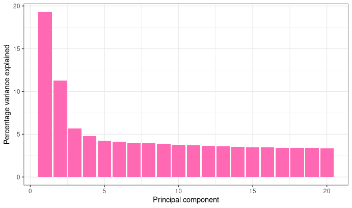
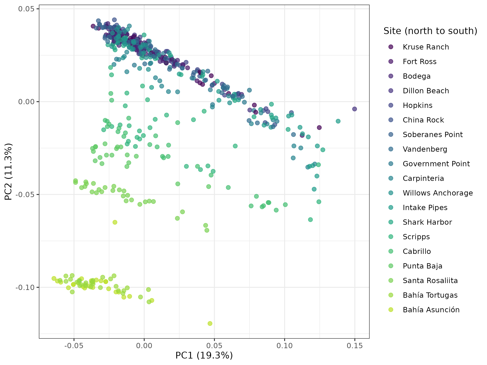
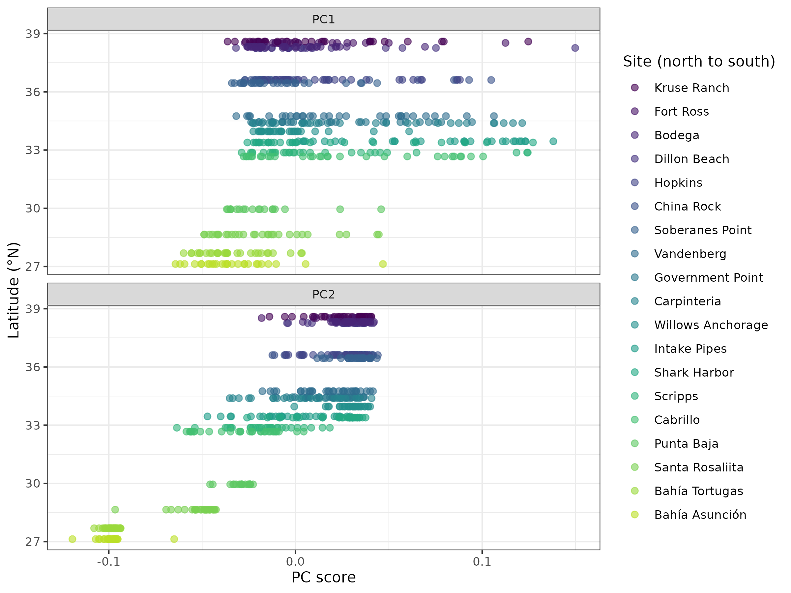
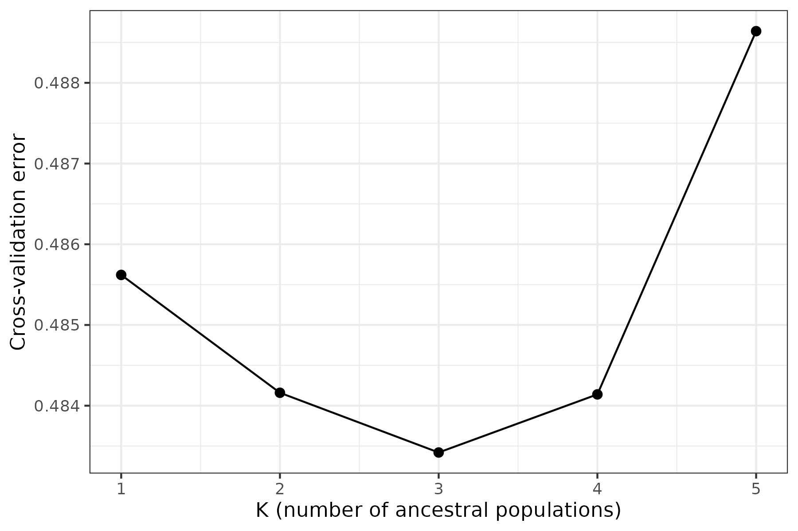
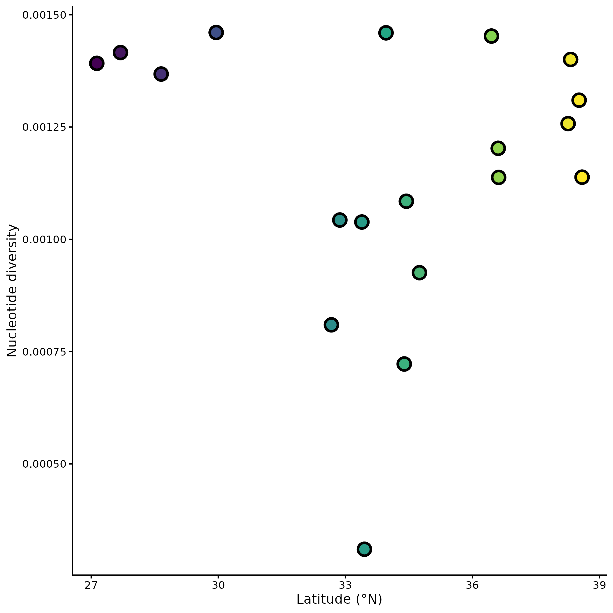
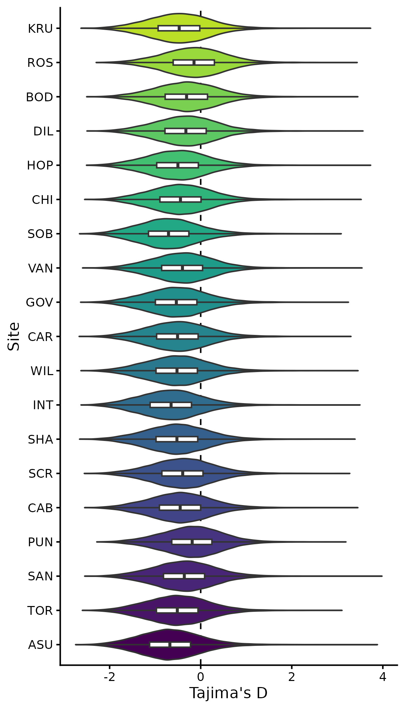
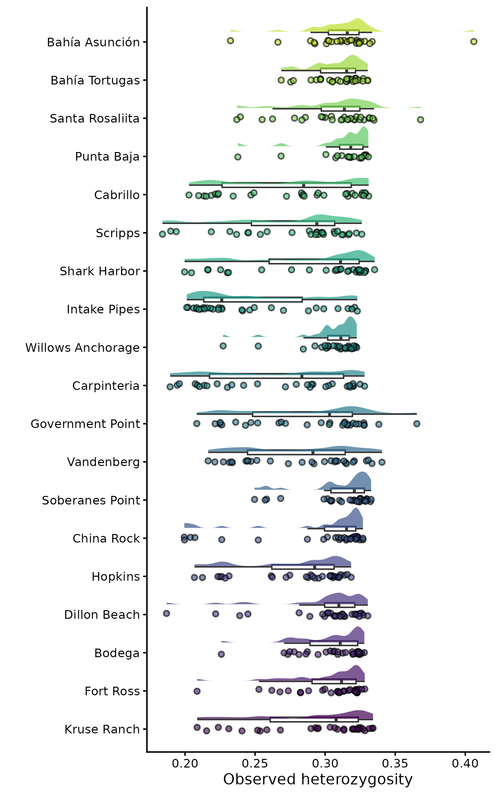
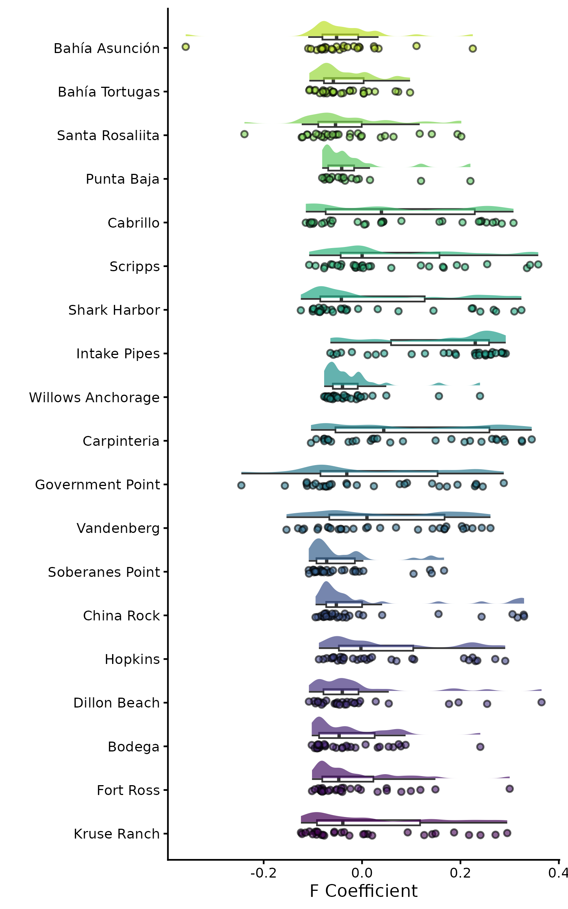
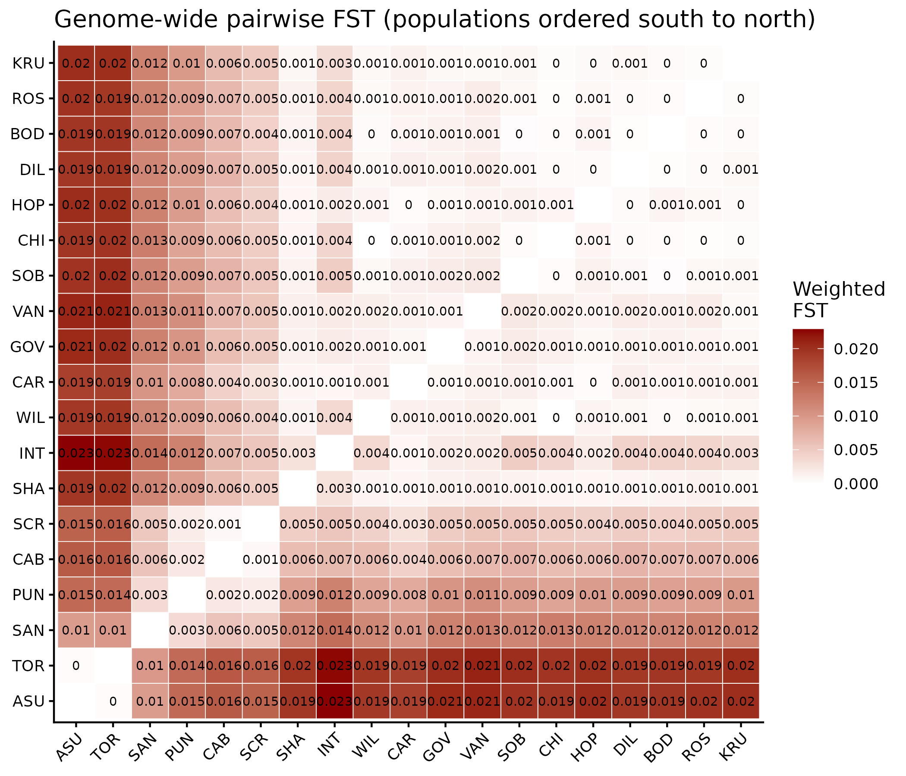
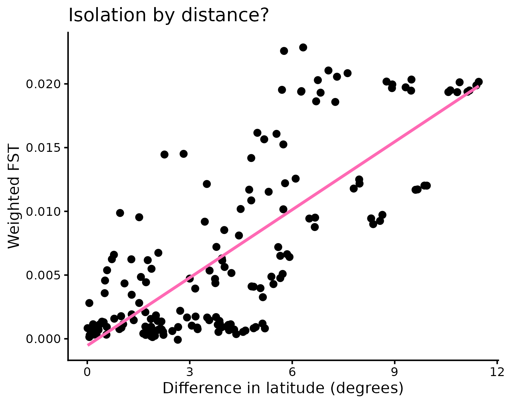

---
title: "pop_gen_ntbk.md"
output: html_document
date: "2026-10-13"
---

## 10. 13. 2026- Looking into VCF files

**Working directory**

`/gpfs1/home/i/t/itimberl/eco_genomics_projects/eco_genomics_2026/population_genomics`

**Input files**

none

**Output files**

none

**Programs/Dependencies**

-   R version 4.5.1

-   R-studio

**Notes/Observations**

-   Reading and preparing VCFs

    -   ./. represents missing data... 1\|11\|0 shows no gaps in the data, the whole genome is known

    -   VCF = variant call format: stores where SNPs are in the genome

    -   fastp = automated fastqc to trim ends and quality scores

    -   Calling variants -\> determining where SNPs are across the genome

    -   More filtering on missingness, phred score, allele rarity

    -   alignment = exact position, mapping = approximate position

-   Moving files over

-   Contig is a DNA fragment

-   Loading modules

    -   bcftools --version \>\> bcftools 1.19 and htslib 1.19

-   The header contains all the information about filtering, summarizing, etc

-   grep grabs a specific thing, or grep -v excludes a certain thing... search function

    ```         
    bcftools view -h Lottia_gigantea_biallelic.vcf.gz | grep "^##FORMAT"
    bcftools head Lottia_gigantea_biallelic.vcf.gz | grep -v "##contig="
    ```

-   553 Samples

-   GT:PL:DP:AD:GQ ... shows each bit of information per sample: genotype, genotype likelihood, depth, allele depth, genotype quality: 0/0:0,9,107:3:3,0:127

-   KB201661.1 333 . A G 234.246 PASS ... head line per sample, shows the base, alleles, quality score, pass of test \## 10. 13. 2026- Looking into VCF files

**Working directory**

`/gpfs1/home/i/t/itimberl/eco_genomics_projects/eco_genomics_2026/population_genomics`

**Input files**

none

**Output files**

none

**Programs/Dependencies**

-   R version 4.5.1

-   R-studio

**Notes/Observations**

-   Reading and preparing VCFs

    -   ./. represents missing data... 1\|11\|0 shows no gaps in the data, the whole genome is known

    -   VCF = variant call format: stores where SNPs are in the genome

    -   fastp = automated fastqc to trim ends and quality scores

    -   Calling variants -\> determining where SNPs are across the genome

    -   More filtering on missingness, phred score, allele rarity

    -   alignment = exact position, mapping = approximate position

-   Moving files over

-   Contig is a DNA fragment

-   Loading modules

    -   bcftools --version \>\> bcftools 1.19 and htslib 1.19

-   The header contains all the information about filtering, summarizing, etc

-   grep grabs a specific thing, or grep -v excludes a certain thing... search function

    ```         
    bcftools view -h Lottia_gigantea_biallelic.vcf.gz | grep "^##FORMAT"
    bcftools head Lottia_gigantea_biallelic.vcf.gz | grep -v "##contig="
    ```

-   553 Samples

-   GT:PL:DP:AD:GQ ... shows each bit of information per sample: genotype, genotype likelihood, depth, allele depth, genotype quality: 0/0:0,9,107:3:3,0:127

-   KB201661.1 333 . A G 234.246 PASS ... head line per sample, shows the base, alleles, quality score, pass of test

## 10. 15. 2026- Fixed VCF file

**Working directory**

`/gpfs1/home/i/t/itimberl/eco_genomics_projects/eco_genomics_2026/population_genomics`{style="padding: 0px 1px; border-width: 1px; border-style: solid; border-color: rgb(230, 230, 230) !important; border-image: initial; background-color: rgb(243, 243, 243) !important; font-family: \"DejaVu Sans Mono\", monospace !important; font-size: 10pt !important;"}

**Input files**

none

**Output files**

**Programs/Dependencies**

-   R version 4.5.1

-   R-studio

**Notes/Observations**

-   Had to fix VCF files

-   looking at submitting a batch job

    -   Use the \## identifiers to tell the computer about your job...

    -   Most can stay the same as default, but change memory

## 10. 20. 2026- Population Structure

-   Filtering based on linkage disequilibrium

-   PCA

-   Admixture

-   Visualization

**Working directory**

`/gpfs1/home/i/t/itimberl/eco_genomics_projects/eco_genomics_2026/population_genomics`{style="padding: 0px 1px; border-width: 1px; border-style: solid; border-color: rgb(230, 230, 230) !important; border-image: initial; background-color: rgb(243, 243, 243) !important; font-family: \"DejaVu Sans Mono\", monospace !important; font-size: 10pt !important;"}

**Input files**

none

**Output files**

sample_metadata.csv

Lottia_gigantea

**Programs/Dependencies**

-   R version 4.5.1

-   R-studio

-   PLINK v1.9.0-b.7.7 64-bit (22 Oct 2024)

**Notes/Observations**

-   Create variable for my data directory:

    ``` {DATA_DIR="/users/i/t/itimberl/eco_genomics_projects/eco_genomics_2026/population_genomics/mydata"}
    ```

    ```{bash}
    plink --vcf $VCF --double-id --allow-extra-chr \
        --set-missing-var-ids @:# \
        --indep-pairwise 50 10 0.2 \
        --out Lg_LD_0.2
    ```

-   Need to allow extra chromosomes and set our own SNP names because this program is built for human data; then prune it for LD \> indep-pairwise, window of 50 SNPS, move by 10 (step size), then filter by r \> .2; then name output file Lg_LD_0.2

    -   this stepwise method, or windows of genomes, also used for other functions, such as calculating nucleotide

-   RStudio PCA visuals

    -   read in eigen vectors values

    -   rename the columns: the first is the sample ID, the rest are PC1, PC2, ...

-   column 1 is population ID, then the eigen vector for each PCA (22 PCAs in total)

-   Change eigen values to percentages of variance explored

    -   look at this scree plot

    -   {width="427"}

    -   shows that mostly PCA 1-3/4 matter/contribute to the variance

-   Make PCA plot:

    -   {width="446"}

    -   see that PC2 has a larger impact from latitude, on population structure

    -   Also see greater population separation in the Southern populations, more range expansion and more mixture in Northernmost

-   Looking at the PCAs by latitude

    -   {width="570"}

-   also cool map by PCA

    -   use maps package !

        -   {width="500"}

-   Admixture ... start with choosing K

    -   Do as a batch job

    -   use admixture package, but takes a long time to load

    -   input is the Lg_LD_0.2.bed file

    -   try with K=1-5

    -   get error rate for each k, k the number of clusters/populations

    -   can take a few hours to loop through values

        -   to add the errors on, use "\>\>" to append rather than overwrite

-   Batch jobs

    -   need to use a full path and not the \~

-   Starting in R with already done data

-   Looking at the cross validation errors for each number of K

    -   {width="536"}

    -   Appears that the best K is 3

-   Plotting ancestry proportions by sample/site

    -   made read_q function to reshape .Q files for different Ks,

    -   bind results together

    -   plot by ancestry proportion, K, and site using column plot

-   Cluster numbers aren’t consistent between runs. “Cluster 1” at K = 3 isn’t necessarily the same ancestral population as “Cluster 1” at K = 4, so the colours can swap between rows.

-   Understanding admixture plot

    -   {width="585"}

    -   see clear differentiation in last/most southern 2 sites, different across

    -   best looking at K=2 or K= 3 but still see lots of mixture in populations

## 10. 22. 2026- Looking at genetic diversity

**Working directory**

`/gpfs1/home/i/t/itimberl/eco_genomics_projects/eco_genomics_2026/population_genomics`{style="padding: 0px 1px; border-width: 1px; border-style: solid; border-color: rgb(230, 230, 230) !important; border-image: initial; background-color: rgb(243, 243, 243) !important; font-family: \"DejaVu Sans Mono\", monospace !important; font-size: 10pt !important;"}

**Input files**

**Output files**

**Programs/Dependencies**

-   R version 4.5.1

-   R-studio

-   vcftools/0.1.16

**Notes/Observations**

-   Can look at genetic diversity....

    -   within an individual (look at particular chromosomes with increased diversity)

    -   within a population

    -   within a species

-   metrics of genetic diversity

    -   heterozygosity

    -   private alleles –\> allele richness

    -   Fst (fixation index - subtotal/total) (intragroup vs. total group)

        -   compares variation between subgroups vs variation in whole group

    -   effective population size

        -   Ne: genetic population size... what individuals are contributing to the next gen

        -   Nc: consensus population size

    -   Nucleotide diversity (pi)

    -   Inbreeding coefficient -\> Fis

    -   Percent Polymorphism

-   p + q = 1 :: Allele frequency; HWE -\> p^2^ + 2pq + q^2^ = 1; 2pq = heterozygotes

    -   H0 = #heterozygotes/ #sampled

    -   Fis = 1 - H0/He (observed/expected)

    -   F = 1 - (.2/.5) = .06 .... less observed than expected -\> decreasing heterozygotes

    -   F = 1 - (.5/.4) = -.25... more than expected -\> excess heterozygotes

    -   F = 0 ... expected number from population

-   Tajima's D = pi - theta/(var\*sqrt(pi-theta)) where theta = Waterson's theta and pi = pairwise nucleotide diversity

    -   theta = S/an = segregating sites over sample size coeffic

    -   If TD = 0, no signatures of selection, unusual demography, or stray from normal

    -   If TD \> 0, there is an excess of common mutations... balancing selection,

    -   If TD \< 0, there is an excess of rare mutations... selective sweep, rapid population expansion, when pi is less than theta

    -   compares 2 ways of calculating genetic diversity... pairwise by pi (more sensitive to rare alleles)

-   Tajima's D needs all data... can not filter out Minor alleles

PATH TO CLASS folder:

`{CLASS: /gpfs1/cl/biol3990/PopulationGenomics/}  ME: /users/i/t/itimberl/eco_genomics_projects/eco_genomics_2026/population_genomics/mydata`

-   Now, data is in /users/i/t/itimberl/eco_genomics_projects/eco_genomics_2026/population_genomics/mydata/GeneticDiversity

-   Calculate pi over samples

    -   create table with headers:

        ```         
        Population Latitude n_windows  mean_pi median_pi
        ```

-   Look at Nucleotide Diversity by population:

    -   

## 10. 27. 2026- Genetic Diversity using Tajima's D and Signatures of Selection

-   Looking at pi/nucleotide diversity across populations and the chromosome

-   Look at heterozygosity and Tajima's D... what they say about selection

-   Signatures of Selection

**Working directory**

`/gpfs1/home/i/t/itimberl/eco_genomics_projects/eco_genomics_2026/population_genomics`{style="padding: 0px 1px; border-width: 1px; border-style: solid; border-color: rgb(230, 230, 230) !important; border-image: initial; background-color: rgb(243, 243, 243) !important; font-family: \"DejaVu Sans Mono\", monospace !important; font-size: 10pt !important;"}

**Input files**

Lottia_gigantea_flt3_sub0.01.vcf.gz

popmap.txt

**Output files**

**Programs/Dependencies**

-   R version 4.5.1

-   R-studio

**Notes/Observations**

-   Looking at pi over latitude differences... scatterplot

    -   {width="332"}

    -   possibly there is a pattern, but varies

-   Plot pi by chromosome region to look at where genetic diversity is highest

    -   further from the center, more recombination so typically less diversity, lower pis

    -   {width="447"}

-   Tajima's D... calculated by VCF

    -   read in files, filter out windows with less than 5 SNPs, add population data back in

-   See lots of negative Tajima's D: signatures of positive selection

    -   positive selection - beneficial new allele appears, shifts allele frequency over, sweeps up

    -   negative selection/purifying -distribution of trait gets more narrow -\> positive Tajima's D

    -   balancing selection -compresses the distribution, makes it wider...

    -   disrupting selection -separating into two peaks, but not accounted for in Tajima's D

-   Plotting Tajima's D by site

    -   {width="459"}

    -   Maybe more negative distribution in the most southern population

-   Heterozygosity: inbreeding coefficient comparison of expected heterozygosity (HWE) to observed

    -   positive- too few heterozygotes

    -   negative- too many

-   Observed heterozygosity

    -   {width="510"}

    -   shows the density of heterozygosity by individuals and by populations... see less in Intake Pipes site, as well as Government Point

-   F = inbreeding coefficient

    -   {width="493"}

    -   how much divergence from hardy-weinberg

        -   lower, excess heterozygotes, so maybe expanding population or selection, maybe relaxing selection pressures

        -   higher, more inbreeding, bottleneck

-   Selection Signatures

-   BioOracle contains data to look at environmental variables such as sea surface temperature, salinity, etc. and to look also at forecasts of future data

-   Calculating FST...

    -   0 = just one population

    -   1 = genetically completely different/distinct

    -   measure of two populations' divergence

    -   negative values = quirk of VCFtools so consider that 0

-   Make a heatmap of Fst, comparing each population

    -   {width="538"}

    -   

-   Look at Fst by population

    -   {width="548"}

-   Scanning Fst across the genome... can see in the Manhattan plot

## 1. . 2026- Template

**Working directory**

`/gpfs1/home/i/t/itimberl/eco_genomics_projects/eco_genomics_2026/population_genomics`{style="padding: 0px 1px; border-width: 1px; border-style: solid; border-color: rgb(230, 230, 230) !important; border-image: initial; background-color: rgb(243, 243, 243) !important; font-family: \"DejaVu Sans Mono\", monospace !important; font-size: 10pt !important;"}

**Input files**

**Output files**

**Programs/Dependencies**

-   R version 4.5.1

-   R-studio

**Notes/Observations**
